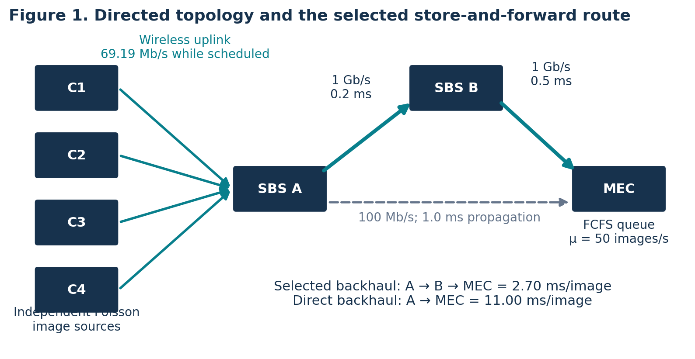
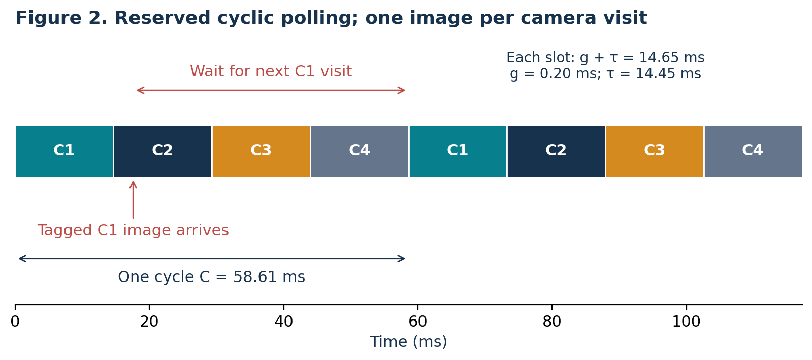
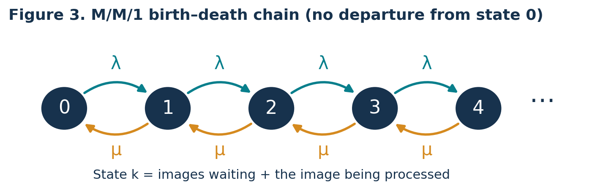
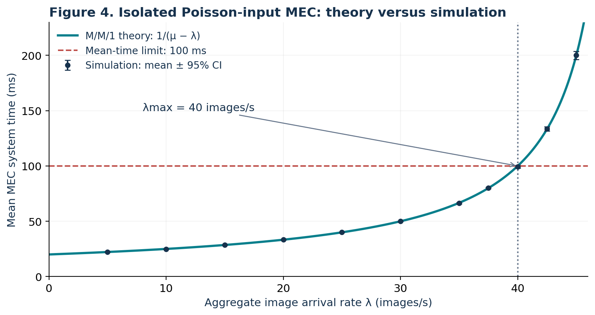
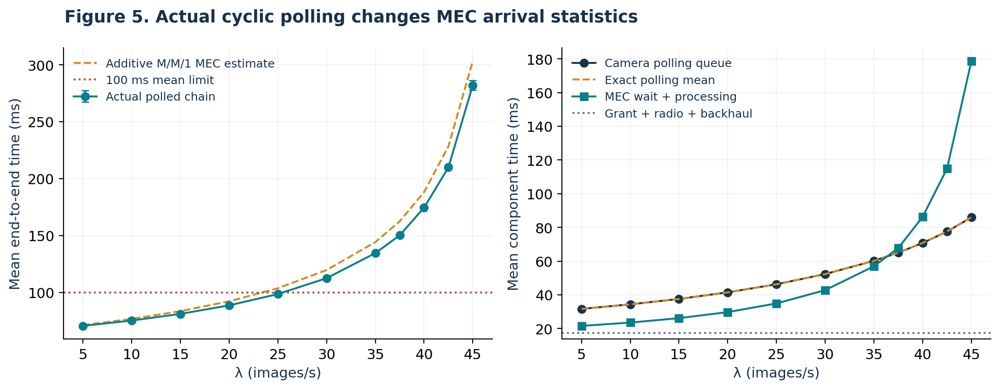
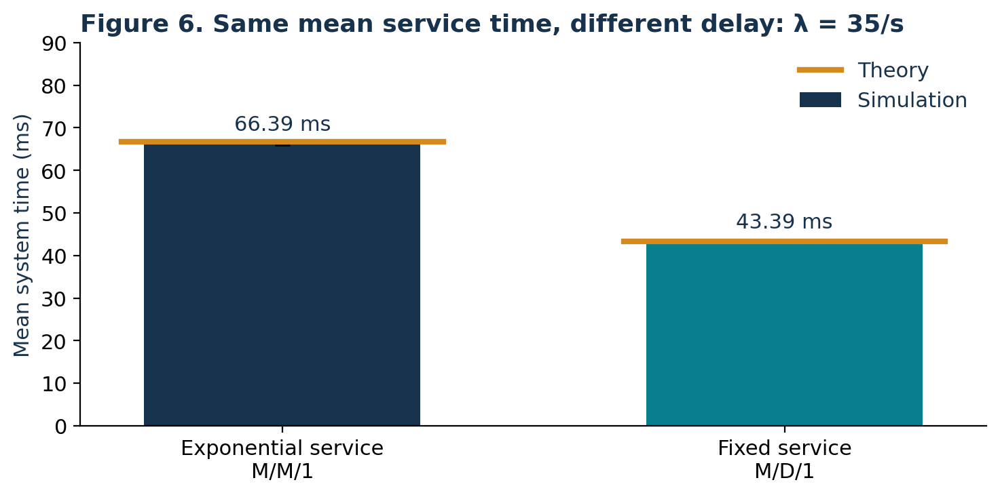
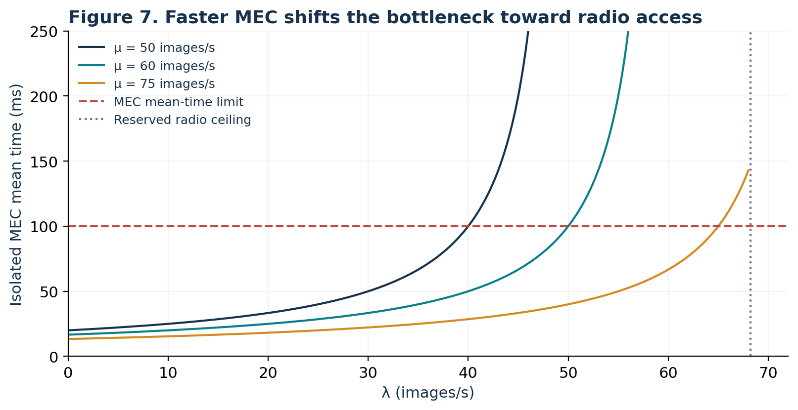

# 1. Executive summary

This project models image delivery for AI-based quality inspection in a 5G smart factory. Four industrial cameras upload images to a small base station (SBS); a cooperating SBS provides an alternative wired route to a multi-access edge computing (MEC) server. The work combines a directed graph, an explicit cyclic polling model and the M/M/1 queue specified in the assessment brief [1]. All numerical inputs are declared modelling choices, because the brief supplies no parameter values. The queue notation follows the supplied lecture slides [2].

At the selected 20 MHz bandwidth and 10 dB signal-to-noise ratio, the ideal scheduled radio rate is **69.19 Mbit/s**. A 1 Mbit image takes **14.45 ms** to transmit. A tagged image with no older image in its camera queue experiences **43.96 ms** mean wireless delay under random-phase polling. Graph routing chooses a two-hop wired backhaul with **2.70 ms** delay, compared with **11.00 ms** for the slower direct link.

For an isolated Poisson-input MEC with service rate 50 images/s, a 100 ms mean system-time limit permits at most **40 images/s**. Across eleven arrival rates, simulation and M/M/1 theory differ by at most **0.62%** in mean time. However, this node-level capacity is not an end-to-end latency guarantee. A separate simulation of the actual polled chain produces **98.52 ms** at 25 images/s and **112.48 ms** at 30 images/s. The highest tested rate meeting the end-to-end mean target is therefore 25 images/s, without claiming an exact threshold between those two points.

At 40 images/s, upgrading both the bandwidth to 40 MHz and the MEC rate to 75 images/s reduces mean end-to-end delay from **174.18 ms to 57.31 ms** in a controlled comparison. Even this upgraded design has an estimated **9.51%** probability of exceeding 100 ms. Meeting a mean-delay target and meeting a stringent per-image reliability target are different design objectives.

# 2. System definition and assumptions

## 2.1 Scope and model boundaries

The image is the unit of work. An arrival at a camera means that capture has completed and the image is ready for transmission. Completion means the MEC has processed that image. Camera exposure, AI accuracy, downlink control, actuation and production-line mechanics are outside the model. The MEC's computation is represented by a random service duration; no AI classifier is trained.

Three related models are used deliberately:

1. **Routing and radio model:** fixed-size images, constant SNR, reserved cyclic grants and deterministic backhaul transmission.
2. **Required analytical queue:** an isolated MEC with Poisson arrivals and independent exponential processing times, exactly matching Task 3 and lecture Section 2.5 [2].
3. **Integrated chain:** Poisson images originate at individual cameras, pass through their real polling queues and then enter the MEC. The MEC input generated by this scheduler is measured rather than assumed Poisson.

The third model checks the boundary of the second. A cyclic scheduler generally changes interarrival times, so the isolated M/M/1 expression must not be treated as an exact formula for the whole chain.

## 2.2 Declared parameters

The representative cell uses four cameras and two SBSs, with SBS B acting as a cooperating relay. This is a small illustrative factory configuration, not a measurement of a deployed network. The camera load is equal across cameras, and the total offered rate is $\lambda=\sum_{i=1}^{N}\lambda_i$, with $\lambda_i=\lambda/N$. Independent Poisson streams superpose to a Poisson stream, as explained on PDF page 49 of the lecture [2].

| Parameter | Selected value | Meaning and reason |
|:--|:--|:--|
| Cameras, $N$ | 4 | Small, reproducible representative cell |
| Mean image size, $S$ | 1 Mbit = $10^6$ bits | Illustrative compressed image; fixed in baseline |
| System bandwidth, $B$ | 20 MHz | Illustrative radio resource budget |
| Scheduled bandwidth, $W$ | 20 MHz | All RBs granted to one camera during its visit |
| SNR | 10 dB, linear value 10 | Constant channel for an interpretable baseline |
| Grant/guard overhead, $g$ | 0.20 ms per visit | Explicit non-payload time |
| MEC service rate, $\mu$ | 50 images/s | Mean processing time of 20 ms |
| Chosen mean-time limit, $T_{\max}$ | 100 ms | Design example; not a value specified by the teacher |
| Arrival-rate sweep | 5–45 images/s | Includes light load and 90% MEC utilisation |
| Buffers and discipline | Unlimited; FCFS | Isolate delay without packet loss or priorities |

All capacities use decimal bit units. SNR is converted from dB before applying Shannon's formula. A constant 1 Mbit image is a baseline approximation to the unspecified image-size distribution; the exponential-size case is treated separately in Section 5.4.

## 2.3 OFDMA and the polling abstraction

OFDMA divides bandwidth into resource blocks. The SBS scheduler determines which camera receives which RBs and when. Here a central cyclic scheduler grants the entire RB set to one camera per reserved visit; the same RBs are reused in time. This is a feasible special case of OFDMA resource scheduling, chosen to implement the polling mechanism required by Task 2. It does not claim the efficiency of a fully optimised 5G scheduler.

Only one camera transmits at a time in this cell. Unused reservations remain idle. Every visit admits at most one image present at the visit start. An image arriving after that instant waits for a later visit. The grant/guard interval precedes payload transmission. Simultaneously assigning $W=B$ to all four cameras would violate the shared-bandwidth constraint and is not done.

# 3. Task 1: graph model and routing

## 3.1 Vertices, edges and attributes

Represent the network as a directed graph $G=(V,E)$ with vertices $V=\{C_1,C_2,C_3,C_4,A,B,M\}$. Directed edges represent the uplink and available backhaul paths. Camera nodes have attributes $(\lambda_i,S)$ and an FCFS image buffer. Node A has the radio bandwidth, polling order and grant duration. Node B is a wired cooperating relay. Node M has an FCFS buffer and exponential processing with rate $\mu$.

{width=95%}

| Directed link | Capacity when used | Propagation delay | 1 Mbit serialization plus propagation |
|:--|:--|:--|:--|
| Each $C_i\to A$ | 69.19 Mbit/s | Neglected at factory scale | 14.45 ms |
| $A\to M$ | 100 Mbit/s | 1.00 ms | 11.00 ms |
| $A\to B$ | 1 Gbit/s | 0.20 ms | 1.20 ms |
| $B\to M$ | 1 Gbit/s | 0.50 ms | 1.50 ms |

The radio capacity is conditional on scheduling; it is not simultaneously available to every camera. Wired links are store-and-forward links. The selected path has two 1 ms serialization stages, so both must be counted. For this single-cell experiment, radio completions are at least 14.65 ms apart, greater than either wired service duration. Hence no backhaul queue forms and its combined delay is a constant 2.70 ms. Additional active cells would require explicit backhaul queues.

## 3.2 Dijkstra route selection

For a fixed-size image, assign each edge the nonnegative snapshot cost

$$w_e=\frac{S}{C_e}+d_e,$$

where $C_e$ is the edge capacity and $d_e$ its propagation delay. Dijkstra's algorithm [4] chooses the path minimising the sum of these costs. Its priority-queue implementation is included in `code/model.py`.

For camera C1, the candidates are

$$D(C_1,A,M)=14.45+11.00=25.45\ \mathrm{ms},$$

$$D(C_1,A,B,M)=14.45+1.20+1.50=17.15\ \mathrm{ms}.$$

Dijkstra therefore selects $C_1\to A\to B\to M$, saving 8.30 ms per image. The algorithm's relaxation step first records the direct path to M, then improves that distance through B. The same decision applies to the other symmetric cameras.

These route costs exclude polling and MEC processing, which are evaluated in the following sections. They optimise unloaded store-and-forward transmission delay for the fixed graph, not every stochastic end-to-end objective. If congestion measurements are available, a nonnegative estimated queueing cost can be added before rerunning the route calculation. A maximum-flow formulation would instead optimise aggregate flow capacity; it need not give the minimum-delay path for one camera. The brief permits either method, and this project implements Dijkstra.

# 4. Task 2: radio transmission and polling delay

## 4.1 Shannon rate and image transmission time

For bandwidth $W$ Hz and linear signal-to-noise ratio $\gamma$, Shannon's ideal capacity is [3]

$$R=W\log_2(1+\gamma)\quad\mathrm{bit/s},\qquad \gamma=10^{\mathrm{SNR}_{dB}/10}.$$

Using $W=20\times10^6$ Hz and $\gamma=10$ gives $R=69.1886\times10^6$ bit/s. With $S=10^6$ bits,

$$\tau=\frac{S}{R}=14.4532\ \mathrm{ms}.$$

This is an ideal payload-time lower bound for the selected channel assumptions. Coding gaps, pilots, retransmissions, fading and interference would normally reduce usable throughput. The model explicitly includes a grant overhead but does not implement a 5G physical-layer stack.

## 4.2 Timing diagram and the no-backlog mean

Define one visit slot as $h=g+\tau$ and one full cycle as $C=Nh$. Numerically, $h=14.6532$ ms and $C=58.6130$ ms.

{width=95%}

First consider an isolated tagged image, with no older images at its camera by construction. Its arrival phase is uniform over a fixed cycle, as for independent Poisson arrival times relative to a periodic schedule. This is a no-backlog reference experiment, not a claim about conditioning a busy queue on being empty. If $U\sim\mathrm{Uniform}(0,C)$ is time since the previous visit, its residual time to the next visit is $C-U$. Thus

$$E[W_{\mathrm{res}}]=\frac{1}{C}\int_0^C(C-u)\,du=\frac C2.$$

Its mean wireless delay, including the grant and actual transmission, is

$$E[D_{\mathrm{wireless,tagged}}]=\frac{N(g+S/R)}2+g+S/R=43.9597\ \mathrm{ms}.$$

This explicitly separates waiting for a visit from payload time. A simultaneous batch placed at the start of a cycle is a different experiment: averaging over camera positions gives $(N-1)h/2+h=(N+1)h/2$, or 36.6331 ms. The random-phase and simultaneous-batch formulas should not be interchanged.

## 4.3 Queued images and the radio stability limit

At non-negligible load, a camera may have older images waiting. Its utilisation per reserved visit is $r=\lambda_i C=\lambda h$. Since only one image is admitted per visit, stability requires $r<1$, hence

$$\lambda<\frac1h=68.2443\ \mathrm{images/s}.$$

For the specified fixed-cycle, one-image discipline with Poisson arrivals, the exact mean time from camera arrival to admission at a visit is

$$E[W_{\mathrm{poll}}]=\frac{C}{2(1-r)}.$$

Appendix A derives this expression using the queue observed after each visit and Little's law. Its low-load limit is $C/2$, consistent with Section 4.2. The complete mean wireless time is $E[W_{\mathrm{poll}}]+g+\tau$. At 25 images/s, the polling wait alone is 46.25 ms; at 40 images/s it is 70.81 ms. Using $C/2$ at every arrival rate would omit camera backlog.

# 5. Task 3: M/M/1 queue and the latency limit

## 5.1 Required assumptions and state transitions

The isolated MEC model uses a Poisson input of rate $\lambda$, independent exponential service times of mean $1/\mu$, one server, an unlimited buffer and FCFS service. The two M symbols denote memoryless interarrival and service times; the 1 denotes a single server. The supplied lecture treats this model on PDF pages 99–106 [2].

Let state $k$ count all images in the MEC system, including the one in service. An arrival changes $k$ to $k+1$ at rate $\lambda$. A service completion changes $k\geq1$ to $k-1$ at rate $\mu$. State 0 has no departure transition.

{width=92%}

Write $\rho=\lambda/\mu$. In steady state, adjacent-state balance gives $\lambda p_k=\mu p_{k+1}$. Therefore $p_k=\rho^k p_0$. Normalisation of the geometric series gives

$$p_0=1-\rho,\qquad p_k=(1-\rho)\rho^k,\qquad 0\leq\rho<1.$$

For $\lambda\geq\mu$, the infinite-buffer system has no finite stationary mean delay. Finite simulation output in that region would not establish stability.

## 5.2 Little's law and average delay

Following the lecture notation, $L_s$ is mean number in the system, $L_q$ mean number waiting, $W_s$ mean system time, and $W_q$ mean waiting time. Summing the geometric distribution and subtracting the mean number being served gives

$$L_s=\sum_{k=0}^{\infty}kp_k=\frac{\rho}{1-\rho},\qquad L_q=L_s-\rho=\frac{\rho^2}{1-\rho}.$$

Little's law [2,5], $L_s=\lambda W_s$ and $L_q=\lambda W_q$, then yields

$$W_s=\frac1{\mu-\lambda},\qquad W_q=\frac{\lambda}{\mu(\mu-\lambda)},\qquad W_s=W_q+\frac1\mu.$$

The assignment's $T$ is $W_s$, including processing, rather than $W_q$ alone. For example, at $\lambda=40$ and $\mu=50$ images/s, $W_q=80$ ms, mean processing is 20 ms and $T=100$ ms. System utilisation is 80%, and $L_s=4$ images.

## 5.3 Maximum supported arrival rate

Applying the mean-time requirement to this queue,

$$T=\frac1{\mu-\lambda}\leq T_{\max}
\quad\Longrightarrow\quad
\lambda\leq\mu-\frac1{T_{\max}}.$$

For $T_{\max}>1/\mu$, the largest admissible rate is

$$\boxed{\lambda_{\max}=\mu-\frac1{T_{\max}}}.$$

With $\mu=50$ images/s and $T_{\max}=0.100$ s, $\lambda_{\max}=40$ images/s. If $T_{\max}<1/\mu$, even the mean service time exceeds the budget; no positive arrival rate can satisfy it. At equality, only the zero-load limit is feasible. These feasibility conditions prevent interpreting a negative bound as a usable capacity.

The same 100 ms value is also used later as an illustrative end-to-end target. This is a stricter requirement because it includes upstream delays. If a constant upstream delay $d$ were appropriate, the corresponding bound would be $\lambda\leq\mu-1/(T_{\max}-d)$, requiring $T_{\max}>d+1/\mu$. In this project the polling delay increases with load, and the MEC input is not Poisson, so the actual chain is assessed by simulation instead.

## 5.4 Further investigation: exponentially distributed image size

To distinguish a random size from its mean, let $X$ be image size in bits and $S=E[X]$. If $X\sim\mathrm{Exp}(1/S)$ and $R$ is constant, transmission service time is $V=X/R$. For $v\geq0$,

$$P(V\leq v)=P(X\leq Rv)=1-e^{-Rv/S}.$$

Thus $V\sim\mathrm{Exp}(R/S)$ and $E[V]=S/R$. With Poisson arrivals, one continuously available transmitter and no additional overhead or scheduling interruptions, the transmission queue is M/M/1 with service rate $\mu_{tx}=R/S$.

If the original image size were constant, its constant-rate transmission time would be deterministic and the corresponding continuously available transmission queue would be M/D/1. If exponential service had already been assumed, the exponential-size assumption supports M/M/1 and does not change it. A fixed grant overhead makes the service time a shifted exponential; cyclic visits impose scheduling restrictions. Neither should silently be described as an ordinary M/M/1 transmission server. The distribution of image transmission time also does not automatically determine the distribution of MEC AI-processing time.

For comparison, an M/D/1 queue with the same mean service time has $W_s=1/\mu+\lambda/[2\mu(\mu-\lambda)]$ [6]. This distributional distinction is checked in Section 6.4.

# 6. Simulation method and validation

## 6.1 Reproducible experiments

The Python simulation uses NumPy and SciPy, with Matplotlib for plots. The base random seed is **20261109**. Independent random streams are assigned by experiment, arrival-rate index and replication. Each of the eleven rates uses **30 independent replications**, each retaining **100,000 image observations** after a **20,000-image warm-up**. Confidence intervals are computed from replication means, not by treating correlated image delays as independent samples:

$$\bar{x}\ \pm\ t_{0.975,29}\frac{s_{\mathrm{rep}}}{\sqrt{30}}.$$

The isolated queue generates exponential interarrival and service durations. It uses the exact FCFS recursion $D_i=\max(A_i,D_{i-1})+V_i$. The implementation evaluates an equivalent cumulative-maximum expression for speed; a test compares it against the scalar recursion. This is an event-based queue simulation, not substitution of the analytical formula.

For the integrated model, each camera generates its own Poisson arrivals. Each image is assigned its earliest admissible reserved visit, with subsequent images at that camera using later visits. A constant backhaul time is added. Images are sorted by arrival at the MEC, then served using the same FCFS recursion with independent exponential processing times. Measurement is by camera arrival time after warm-up. All selected images are followed to completion. Boundary assertions verify that the generated competing traffic extends beyond the latest selected MEC arrival.

CSV files contain all replication-level means and aggregate summaries. `configuration.json` records inputs, derived constants and route choice. The measured end-to-end decomposition is checked directly: polling wait + grant + radio transmission + backhaul + MEC time.

## 6.2 Isolated M/M/1 results

{width=90%}

| λ (images/s) | Theory (ms) | Simulation ± 95% CI (ms) | Relative error |
| --- | --- | --- | --- |
| 5 | 22.22 | 22.23 ± 0.03 | +0.022% |
| 10 | 25.00 | 24.93 ± 0.04 | -0.279% |
| 20 | 33.33 | 33.30 ± 0.09 | -0.094% |
| 30 | 50.00 | 49.99 ± 0.23 | -0.027% |
| 35 | 66.67 | 66.38 ± 0.50 | -0.428% |
| 40 | 100.00 | 99.38 ± 1.26 | -0.617% |
| 45 | 200.00 | 200.10 ± 3.66 | +0.049% |

The largest relative difference between the theory and the simulated mean is **0.617%**. Ten of eleven pointwise 95% intervals cover their theoretical values. At 10 images/s the small difference is outside its narrow interval; a collection of 95% intervals is not guaranteed to cover every point simultaneously. No seed was selected to force agreement. The small absolute errors and deterministic algorithm checks support the implementation while preserving this statistical observation.

An independent time-average occupancy calculation includes jobs crossing the measurement-window boundaries. Its mean absolute relative difference from the finite-window $\hat\lambda\hat W_s$ estimate stays below **0.013%** across the tested rates. This provides a numerical Little's-law audit in addition to formula comparison.

## 6.3 Polling and integrated-chain results

The no-backlog tagged-image experiment gives **43.955 ms**, with a 95% interval half-width of **0.015 ms**, compared with 43.960 ms analytically. For the queues at all tested loads, the largest relative difference between the exact polling mean and simulation is **0.143%**.

{width=98%}

| λ (images/s) | Polling wait (ms) | MEC time (ms) | End-to-end ± 95% CI (ms) |
| --- | --- | --- | --- |
| 5 | 31.66 | 21.56 | 70.57 ± 0.03 |
| 20 | 41.47 | 29.75 | 88.58 ± 0.09 |
| 25 | 46.28 | 34.89 | 98.52 ± 0.12 |
| 30 | 52.33 | 42.80 | 112.48 ± 0.24 |
| 40 | 70.78 | 86.33 | 174.47 ± 1.12 |
| 45 | 85.99 | 178.78 | 282.13 ± 4.34 |

The highest tested rate whose upper 95% confidence limit for the mean stays below 100 ms is **25 images/s**. The 30 images/s result is above the limit. This is a statement about the tested grid, not an exact calculation of the continuous end-to-end capacity. An operating point of **20 images/s** provides more margin: mean delay is 88.58 ms, compared with 98.52 ms at 25 images/s.

At 40 images/s, the squared coefficient of variation of MEC interarrival times is approximately **0.433**, compared with 1 for independent exponential intervals. Periodic scheduling smooths the arrivals, while also imposing camera waiting. Interarrival correlations can still exist; the shape statistic alone does not define a renewal process. The simple sum of exact polling delay and a Poisson-input M/M/1 MEC mean predicts 188.16 ms, whereas the actual chain gives 174.47 ms. We report the difference rather than claim that the analytical approximation exactly describes the chain.

## 6.4 Service-time distribution check

{width=85%}

At 35 images/s and a 20 ms mean service time, the exponential-service queue gives **66.39 ms**, against 66.67 ms theory. The fixed-service queue gives **43.39 ms**, against 43.33 ms theory. This confirms that a mean rate alone does not identify the queueing model. The simplified M/D/1 comparison uses a continuously available server, so it must not be substituted for the cyclic polling queue.

## 6.5 Verification and practical difficulties

Ten deterministic tests pass. They cover units in the Shannon formula, the worked lecture example (PDF pages 104–106), stability rejection, Little identities, a hand-calculated FCFS sequence, scalar-versus-vectorised FCFS, polling visit boundaries, scalar-versus-vectorised polling, occupancy integration and the shortest route. Numerical output checks confirm the number of rate points, error bounds, positive confidence widths, polling agreement and end-to-end component conservation.

The main modelling difficulties were reconciling OFDMA with the specified polling experiment, distinguishing waiting from total system time, and avoiding the false assumption that polling preserves Poisson traffic at the MEC. The explicit resource rule, separate symbols and integrated simulation address these issues. Near saturation the queue is more variable; independent replications and reported intervals prevent hiding that variation behind a single run.

# 7. Bottlenecks and optimisation

## 7.1 Capacity and latency are different limits

The baseline radio can admit fewer than 68.24 images/s, while the MEC is stable only below 50 images/s. Thus the MEC sets the baseline throughput ceiling. However, even below both ceilings, the radio's reserved waiting time consumes a substantial part of the latency budget. At 40 images/s, mean polling wait is 70.78 ms and MEC time is 86.33 ms, with another 17.35 ms for the grant, payload and backhaul.

{width=90%}

Increasing $\mu$ to 60 or 75 images/s changes the isolated 100 ms bound to 50 or 65 images/s respectively. These are node-level calculations. They do not guarantee 100 ms delivery through the upstream polling system.

## 7.2 Controlled integrated design comparison

A further 30-replication experiment holds the offered load at 40 images/s and evaluates resource upgrades under the same polling rule, image size and backhaul. SNR remains 10 dB when bandwidth increases; this assumes sufficient power to maintain that SNR, rather than a fixed total-power budget. Hardware, spectrum and energy costs are not quantified. Common random numbers are used across the four designs within each replication, while replications remain independent.

| Design | MHz / MEC images/s | Mean total ± 95% CI (ms) | Over 100 ms |
| --- | --- | --- | --- |
| Baseline | 20 / 50 | 174.18 ± 1.20 | 70.79% |
| Faster MEC | 20 / 75 | 110.29 ± 0.28 | 45.47% |
| More bandwidth | 40 / 50 | 127.64 ± 1.15 | 48.77% |
| Both upgrades | 40 / 75 | 57.31 ± 0.10 | 9.51% |

Either resource upgrade alone still misses the chosen 100 ms mean target at this load. Combining both upgrades reduces the mean by approximately **67.1%** from the controlled baseline. This supports a joint radio-and-compute recommendation rather than assuming that faster MEC processing alone resolves all delay.

Additional practical options are to select the faster backhaul route, compress images subject to detection-quality checks, skip empty polling visits, or allocate RBs dynamically. Their precise gains are not quantified by the fixed-cycle experiment. Dynamic schedules require new analysis and simulation; compressing images may change both AI accuracy and computing time.

## 7.3 Mean delay versus reliability

The brief asks for a mean-time constraint and refers generally to high reliability without giving a numerical reliability target. For the isolated M/M/1 queue, $P(T>t)=e^{-(\mu-\lambda)t}$. At $\lambda=40$, a mean of 100 ms still permits **36.8%** of images to exceed 100 ms.

For the actual baseline chain at 25 images/s, the mean is below 100 ms but the simulated deadline-miss fraction is **39.17%**. Even the combined upgrade at 40 images/s has **9.51%** deadline misses. These findings show that a stricter per-image guarantee would require additional resource provisioning or scheduling changes and an explicit target. For illustration, a 1% miss target for the isolated MEC alone would require $\lambda\leq\mu-\ln(100)/0.1$, or approximately 3.95 images/s at $\mu=50$. This illustrative reliability target is not presented as an assignment requirement.

# 8. Conclusions and limitations

The project fulfils the three modelling tasks with a directed topology and computed route, a Shannon-rate and polling derivation, and an M/M/1 state model using Little's law. Simulation closely reproduces the required analytical queue and the explicitly defined polling discipline. The end-to-end experiment explains why a 40 images/s isolated-MEC bound cannot be reused as an end-to-end latency capacity.

For the chosen baseline, 25 images/s is the highest tested rate meeting a 100 ms mean end-to-end target, with little margin; 20 images/s is a more cautious operating point. At 40 images/s, joint radio and MEC upgrades meet the mean target in the model, while the deadline-miss results show that high reliability requires a separate design check.

The conclusions are conditional on equal independent camera traffic, fixed-size baseline images, constant SNR, reserved cyclic polling, unlimited buffers, one active camera cell, loss-free links and exponential independent MEC service. Real deployments require measured arrival and processing distributions, interference and retransmission modelling, finite buffers, competing cells and AI-accuracy assessment. The work provides reproducible mathematical and simulation evidence, not a hardware performance guarantee.

# 9. Team responsibilities

The group assigns primary ownership as shown below, with cross-review of the complete model by all members. Each member is responsible for checking their calculations and code, preparing their report section, and participating in the presentation and questions. The final contribution record should reflect any changes made during preparation.

| Member and student ID | Technical ownership | Shared deliverables and presentation |
|:--|:--|:--|
| Sun Jiangeng — 202612491511 | Topology, edge attributes, Dijkstra route and parameter justification | Write/review Sections 2–3; check file organisation and report format; present slides 1–5 |
| Qian Tu — 202612491508 | Shannon rate, OFDMA interpretation, polling derivations and polling simulation | Write/review Section 4 and relevant simulation method; check diagrams and units; present slides 6–9 |
| Lu Zipeng — 202612491522 | M/M/1 derivation, delay bound, service-size investigation and MEC validation | Write/review Section 5 and numerical comparisons; check references and results; present slides 10–14 |

All three members jointly review the integrated-chain results, optimisation, conclusions, final report and Q&A. Rehearsal targets are 3 minutes 20 seconds per member, totalling 10 minutes. The accompanying speaker script follows this division.

# References

[1] Communication Networks. *Continuous Assessment Brief: Project Structure & Overview 2026–2027*. SETU (Waterford), Higher Certificate and B Eng in Electronics, Year 1. Issued 7 November 2026; due 21 November 2026. Supplied assignment document.

[2] *Communication Networks, Chapter 2: Queueing Theory and Its Applications* (in Chinese). Supplied course lecture slides, 215 PDF pages. Relevant PDF pages: 43–46, 49, 88–89, 94–106. PDF page numbers are one greater than the printed slide numbers in these sections.

[3] Shannon, C. E. (1948). A mathematical theory of communication. *The Bell System Technical Journal*, 27(3), 379–423. DOI: 10.1002/j.1538-7305.1948.tb01338.x.

[4] Dijkstra, E. W. (1959). A note on two problems in connexion with graphs. *Numerische Mathematik*, 1, 269–271. DOI: 10.1007/BF01386390.

[5] Little, J. D. C. (1961). A proof for the queuing formula: L = λW. *Operations Research*, 9(3), 383–387. DOI: 10.1287/opre.9.3.383.

[6] Kleinrock, L. (1975). *Queueing Systems, Volume 1: Theory*. Wiley. Standard single-server queueing and service-time variability results.

# Appendix A. Exact mean for reserved one-image polling

For one camera, let $Q_k$ be the number waiting just after admission at visit $k$. Let $A_k$ count arrivals before the next visit. The cycle length is fixed and arrivals are Poisson, so $A_k\sim\mathrm{Poisson}(r)$, independent of $Q_k$, where $r=\lambda_i C$. The embedded recursion is

$$Q_{k+1}=\max(Q_k+A_k-1,0).$$

In steady state, mean admissions per cycle equal mean arrivals $r$, so $P(Q_k+A_k>0)=r$. Writing $Z=Q_k+A_k$, use $(Z-1)^+=Z-1+\mathbf1_{Z=0}$ and $[(Z-1)^+]^2=(Z-1)^2-\mathbf1_{Z=0}$. Since $E[A_k^2]=r+r^2$, stationarity of the second moment gives

$$0=2(r-1)E[Q]+r^2,\qquad E[Q]=\frac{r^2}{2(1-r)}.$$

Between visits, the average number accumulated is $\lambda_i C/2=r/2$. The time-average number awaiting admission is therefore

$$L_{\mathrm{poll}}=E[Q]+\frac r2=\frac r{2(1-r)}.$$

Little's law gives $E[W_{\mathrm{poll}}]=L_{\mathrm{poll}}/\lambda_i=C/[2(1-r)]$. This wait ends at admission, before the grant and transmission, so $g+\tau$ must then be added. The derivation requires $r<1$ and the specified reserved-visit rule.

# Appendix B. Reproduction and requirement checklist

From the project root, use Python 3.12 and run:

```bash
python -m venv .venv
# Linux/macOS: source .venv/bin/activate
# Windows: .venv\Scripts\activate
python -m pip install -r requirements.txt
python code/test_model.py
python code/run_simulations.py
python code/run_scenarios.py
python code/check_results.py
python code/make_figures.py
```

| Required item | Location in this package |
|:--|:--|
| Network topology, vertex/edge attributes and routing | Report Section 3; Figure 1; `model.py` |
| Shannon capacity and transmission delay | Report Section 4.1 |
| Polling timing diagram and average-delay derivation | Report Sections 4.2–4.3; Figure 2; Appendix A |
| M/M/1 state diagram and Little derivation | Report Sections 5.1–5.3; Figure 3 |
| Maximum supported arrival rate | Report Section 5.3 |
| Exponential-size investigation | Report Section 5.4 |
| Code, delay curves and theory comparisons | `code/`, `results/`, `figures/`; Report Section 6 |
| Bottlenecks and optimisation recommendations | Report Section 7 |
| English report, cover, contents and responsibilities | Report PDF/Word; Section 9 |
| 10-minute presentation and questions | 14-slide deck and speaker/Q&A notes |

The PDF is the fixed-layout printing copy. The Word version is editable; update its contents field after editing. The supplied brief requires both electronic and paper report submission. The deadline is 21 November 2026; submission time, platform and presentation date were not specified in the supplied document.
