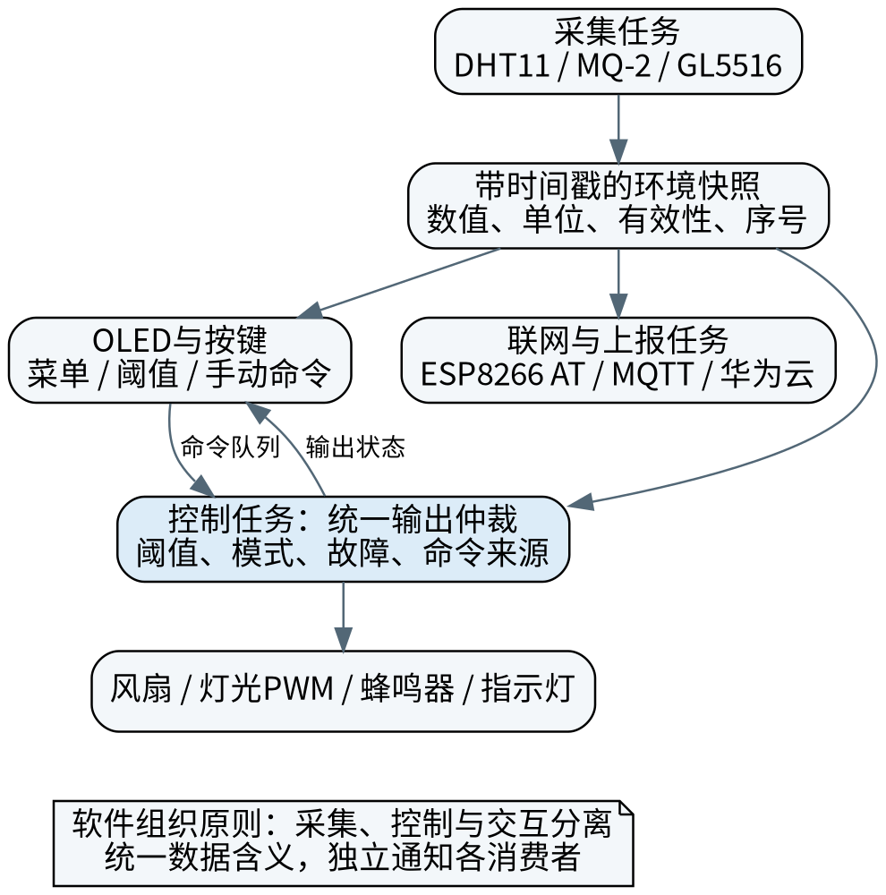

# 摘要 {.unnumbered}

针对教学楼宇单房间环境监测、设备联动和多方式交互的需求，本文设计一套基于FreeRTOS的智能楼宇控制系统，通过云平台实现远程数据展示。系统以STM32F103C8T6为核心，使用DHT11、MQ-2和GL5516获取温湿度、气敏响应和光照信息，结合OLED显示、按键设置、风扇控制、灯光PWM调节及声光报警，实现本地环境监测与控制。ESP8266负责联网与数据上传，华为云用于环境数据展示。软件基于FreeRTOS组织采集、控制、显示和网络任务，并从硬件抽象、生产者—消费者、状态机及统一输出仲裁等方面分析模块协作。报告给出了总体方案、主要接口、电路原理、数据处理方法和软件流程，并依据小组技术文档对功能完成情况作定性分析。该方案将多种外设实验组合为具有明确应用背景的综合课程设计，体现了嵌入式软硬件协同与模块化开发的方法。

**关键词：**智能楼宇；STM32；FreeRTOS；OLED；MQTT；云平台

# Abstract {.unnumbered}

This paper presents a multitasking smart building control system for environmental monitoring and interaction in a single-room teaching scenario. An STM32F103C8T6 microcontroller acquires temperature, humidity, gas-sensor response, and light information through DHT11, MQ-2, and GL5516 modules. An OLED display and keys provide local interaction, while a fan, PWM lighting, a buzzer, and indicators support environmental control and alarms. An ESP8266 module provides networking and data upload to Huawei Cloud. FreeRTOS organizes sensing, control, display, and networking tasks. Hardware abstraction, producer–consumer communication, state machines, and actuator arbitration are discussed to explain module cooperation. The report covers the architecture, electrical interfaces, data processing, software flows, and team responsibilities. Functional outcomes are analyzed qualitatively using the team's technical documentation. The project illustrates hardware–software integration and modular development in an embedded systems course.

**Keywords:** smart building; STM32; FreeRTOS; OLED; MQTT; cloud platform

# 1 概述

## 1.1 应用背景与任务

本课题将一间教学楼实验室或办公室作为模拟楼宇单元。管理人员需要在现场查看温湿度、气敏响应与光照状态，根据环境变化控制照明及通风，通过声光提示获知异常，并能够在云端查看数据。系统围绕一个房间的低压模型展开，便于课堂演示和模块调试。

本项目采用STM32F103C8T6、DHT11、MQ-2、GL5516、OLED与ESP8266，构成感知、处理、执行和交互的完整链路。相比单独完成传感器或显示实验，综合系统还需要解决数据格式不一致、多任务资源共享及不同控制来源的协调问题。

## 1.2 设计依据与研究方法

报告以小组技术文档[1]为主要设计依据，按照课程指导书[2]组织需求分析、总体设计、电路设计、数据处理、软件流程、功能分析与总结。相关毕业设计[3]提供了已有技术基础，STM32和FreeRTOS资料[4-5]用于理解外设资源和任务组织。

设计过程遵循先明确应用需求、再划分模块和接口、最后进行功能联调的思路。对数据采集、显示、控制和通信分别定义职责，使单模块问题能够单独定位，整体功能也能够通过统一数据接口进行协作。

## 1.3 设计目标

系统实现环境数据采集与显示、阈值设置、蜂鸣器和指示灯报警、风扇控制、灯光PWM、云端数据展示。云功能以数据上传和远程查看为主，本地控制在网络不可用时仍应保持独立运行。

课程设计重点是解释系统为什么采用这些模块、各模块怎样连接和协同，以及采用哪些软件组织方法解决具体问题。报告按功能完成情况进行分析，量化精度、长期稳定性和产品级安全认证属于进一步研究内容。

# 2 国内外发展与应用现状

## 2.1 环境监测与本地控制

环境监测装置逐步由独立仪表发展为具备现场控制、数据上传和远程展示能力的嵌入式节点。温湿度和光照是室内舒适性管理的常见输入，气敏模块可用于异常响应演示，灯光与风扇则构成直观的执行对象。

文献[3]展示了多传感器、OLED与Wi-Fi协作的应用实例。本课程设计在此基础上围绕单房间模型展开，侧重统一接口、多任务协作与控制逻辑。与需要专用基础设施的大型楼宇管理系统相比，微控制器节点便于以较低成本完成课堂功能展示。

## 2.2 多任务与云通信

FreeRTOS为任务、队列、互斥量和通知提供基础机制，实际响应仍取决于任务执行时间、阻塞关系和中断使用[5]。MQTT用于设备与平台交换主题消息，AT接口用于主控与通信模块交换命令；两者属于不同层次，不能把AT命令的OK响应当作云端已经收到数据。

## 2.3 本课题的设计重点

硬件抽象、生产者—消费者、有限状态机和策略分离等方法[6-7]能够将采样、决策与交互分开，减少模块之间的直接依赖。本课题将这些方法落实到环境快照、命令队列、联网状态机和统一执行器控制入口中，重点提高系统的可理解性和扩展性。

# 3 系统原理分析与总体设计

## 3.1 功能需求与输入输出

输入包括DHT11数字数据、MQ-2与GL5516的模拟输出、按键操作和ESP8266通信状态。输出包括OLED页面、风扇和灯光控制、蜂鸣器与报警灯状态以及云端环境属性。每次展示和上传应能追溯到同一份带序号的采样快照。

| 功能 | 需求 | 对应模块 |
|---|---|---|
| 环境采集 | 温度、湿度、烟雾/气敏响应、相对光照 | DHT11、MQ-2和GL5516采集模块 |
| 本地控制 | 阈值判断、蜂鸣器与指示灯、风扇、灯光PWM | 阈值判断、报警与PWM控制模块 |
| 显示与按键 | 实时数据、菜单切换、阈值设置 | OLED显示与按键模块 |
| 上云 | 联网、MQTT、数据封装与定时上传、展示 | ESP8266、MQTT与华为云服务 |

## 3.2 性能、数据与运行环境

系统主控为STM32F103C8T6，按72 MHz主频、64 KB Flash和20 KB SRAM进行资源规划。电源为5 V负载和3.3 V逻辑提供供电，云连接需要可用的无线网络与华为云设备配置；OLED、按键及本地控制不依赖云端页面。

| 项目 | 设计内容 | 作用 |
|---|---|---|
| 处理器 | STM32F103C8T6 | 承担采集、控制与多任务管理 |
| 显示 | 1.3英寸、128×64 OLED | 显示环境参数、阈值与设备状态 |
| Wi-Fi通信 | ESP8266，串口115200 bit/s | 通过AT交互实现联网与上传 |
| 模拟量采集 | ADC1读取气敏和光照模块 | 提供阈值判断与灯光调节依据 |
| 数据组织 | 数值、单位、有效性和更新时间 | 统一OLED和云端的数据含义 |

温湿度、ADC原始量和归一化指标分开保存；控制状态包含模式、阈值、执行器输出及报警状态。这样的数据划分既便于显示，也便于判断数据是否已经过期。

## 3.3 方案比较与总体结构

相较于单一轮询主循环，多任务结构更便于协调网络等待、界面交互和采集周期；代价是需要预算栈、控制共享数据和处理阻塞。相较于全部依赖云端控制，本地规则可在断网时继续运行。

![图3-1 智能楼宇控制系统结构图（根据资料[1]整理）](figures/system.png){width=95%}

系统由环境感知、本地控制、人机交互和云服务四部分构成。图中模块箭头表示功能关系，实际数据并非通过一条公共硬件总线传输：DHT11为单总线、两路模拟量由ADC读取，OLED使用I2C，Wi-Fi使用USART1。

# 4 系统电路设计

## 4.1 模块连接与接口分配

![图4-1 主要模块连接示意图（根据资料[1]整理）](figures/connections.png){width=100%}

系统以STM32F103C8T6最小系统为核心，主要传感器、显示与通信接口按小组技术文档整理如下。Wi-Fi统一称为ESP8266系列，串口连接按“发送端接对方接收端”的原则说明。

| 部件 | 主控接口 | 功能 |
|---|---|---|
| DHT11 | PB12，3.3 V供电 | 数字温湿度采集 |
| MQ-2 | PA1/ADC1_IN1，模块5 V供电 | 气敏模拟量采集 |
| GL5516 | PA6/ADC1_IN6，3.3 V供电 | 光照模拟量采集 |
| OLED | PB8=SCL，PB9=SDA | I2C显示接口 |
| ESP8266 | PA9=MCU TX，PA10=MCU RX | 与Wi-Fi模块交叉收发连接 |
| 蜂鸣器 | PB13 | 异常声音提示 |
| 状态灯、报警灯 | PA5、PA4 | 运行与报警指示 |
| 照明灯 | PA0 | 灯光PWM控制接口 |
| 电机控制 | PB4→AIN1、PA8→AIN2 | 电机控制信号；功率部分见4.4节 |
| 按键 | PB14、PB15、PB1、PB0 | 菜单、切换与阈值设置 |

图4-1为主要信号接口示意，不代替完整的电气原理图。Wi-Fi按照上表交叉收发连接；电机PWM及使能的具体连接未在现有资料中完整标明，因此不指定未经确认的PWMA引脚。

## 4.2 传感器与ADC输入

DHT11以40位数据帧提供湿度、温度和校验字节。驱动应校验应答时序、数据长度和校验和；读取失败时标记无效，而不是把0写成真实环境值。微秒级单总线协议需要计时能力，不能用覆盖整个事务的长时间关中断来保证时序。

MQ-2使用5 V加热供电不意味着MCU ADC也以5 V为参考。若STM32的VDDA为3.3 V，12位ADC端电压近似为

$$V_{ADC}=\frac{N}{4095}V_{DDA}.\tag{4-1}$$

传感器的5 V供电与ADC参考电压是不同参数。本文采用实际VDDA进行换算；对于可能超过ADC允许范围的模拟输出，应通过适当分压或接口保护再接入。RC低通用于滤波，不能替代直流电平转换。

例如上臂12 kΩ、下臂18 kΩ时，5 V输入名义缩放为3.0 V：

$$V_{ADC}=V_{AO}\frac{18}{12+18}=0.6V_{AO}.\tag{4-2}$$

若使用该方案，程序还须除以0.6恢复模块输出，并检查源阻抗、ADC采样时间和滤波影响。该计算用于说明电平匹配的方法，示例电阻不作为实物装配值。

GL5516电阻通常随光照增强而减小，但模块AO与光照同向还是反向取决于分压连接。必须先做遮挡与照射测试，再决定指数方向。PA6作为ADC输入时不同时分配为SPI1 MISO。

## 4.3 显示与按键

OLED提供128×64单色显示，技术文档采用SSD1306接口说明。显示层将传感器数据、菜单选项和设备状态组织为页面，驱动层负责初始化、地址设置与数据传输。

PB8/PB9若由硬件I2C1使用，需要正确设置重映射；若使用软件I2C，应保证开漏或等效释放总线的行为，并检查上拉。单色全屏缓存需要$128\times64/8=1024$ B，能够纳入20 KB SRAM预算，但刷新周期仍会影响共享总线及CPU负载。按键经稳定计数或时间窗去抖后生成短按、长按和确认事件。

## 4.4 风扇、灯光与报警驱动

风扇由直流电机带动，STM32提供开关或调速控制信号。电机控制需要区分逻辑信号与负载供电：GPIO用于输出控制信号，电机工作电流应通过匹配的驱动级和电源供给。技术文档画出了方向、使能和PWM接口，本文据此讨论驱动原理；其PWM及使能的具体连接不由图中未标明的网络推断。

灯光亮度通过改变PWM占空比调节。PWM频率和占空比可表示为：

$$f_{PWM}=\frac{f_{TIM}}{(PSC+1)(ARR+1)},\qquad D=\frac{CCR}{ARR+1}.\tag{4-3}$$

其中$f_{TIM}$为定时器输入时钟，PSC为预分频值，ARR为自动重装值，CCR为比较值。程序调整CCR即可改变有效输出时间比例。风扇启停、灯光调节、蜂鸣器和报警灯由统一控制入口管理，避免多个任务产生相反命令。

PB4用作GPIO时需释放JTAG功能并保留SWD；灯光与电机负载均需要匹配的限流或驱动电路。电机电源线不应直接接GPIO供电。

## 4.5 Wi-Fi与电源

ESP8266通过USART1与STM32通信，模块TX连接PA10，模块RX连接PA9。串口两端使用一致的波特率、数据位、停止位和校验配置。AT命令负责控制模块联网并获取状态，MQTT服务负责与华为云交换数据。报告以ESP8266系列为统一名称描述通信方案。

原理图使用AMS1117-3.3提供3.3 V电源。联网和电机启动都会带来瞬态负载，需要合理去耦并安排共地。稳压器功耗近似为$(5-3.3)I$，适当的电源余量和散热可减少复位与通信异常。

# 5 数据处理方法分析

## 5.1 数据有效性和统一接口

采集模块建议统一输出“数值、单位、有效标志、时间戳”。温湿度可使用定点整数；ADC原始量保留12位码值，归一化指标与原始量分开保存。这样OLED和云端可以使用同一套语义，避免某一端把0～100的响应值标成ppm。

数字量先验证校验和，模拟量先检查范围和采样状态。多次失败应显示故障或数据过期，不能以最后一次有效值无限期代替当前值。滤波参数、失效超时和恢复条件集中配置，并记录其单位和来源。

## 5.2 气敏与光照数值的解释

MQ-2对多种气体具有响应，其数值受预热、温湿度及标定条件影响。本课程以ADC原始量和相对气敏响应说明阈值控制，经验浓度换算可作为理解传感器特性的参考，不据此给出未标定的ppm精度。

若电路确为已知负载电阻分压，传感器电阻的计算可写为

$$R_S=R_L\left(\frac{V_C}{V_{out}}-1\right).\tag{5-1}$$

这里$V_{out}$为恢复后的传感器分压电压，不能直接使用被额外分压后的ADC节点电压；$V_{out}=0$或超量程必须单独处理。模块实际负载电阻若与文档的0.5 kΩ不同，也必须同步修改。

GL5516用于识别相对明暗变化。界面可使用“黑暗、昏暗、正常、明亮”等等级，帮助使用者理解灯光调节行为。OLED和云端使用一致的单位或等级描述，避免将相对指数误读为标准照度。

## 5.3 滤波、回差与PWM策略

可对模拟采样采用中值或低通处理，减小单次跳变。若采用一阶平滑，表达式为

$$y_k=\alpha x_k+(1-\alpha)y_{k-1},\quad 0<\alpha\le1.\tag{5-2}$$

滤波降低噪声但会增加响应延迟，窗口和系数可根据演示时的数据波动调整。此式说明可采用的数据处理方法，不表示已经测得最优参数。阈值判断建议使用不同的触发与解除阈值，避免在边界附近反复启停。

照明PWM可按相对光照分档或连续映射；风扇控制应明确依据温度还是其他环境量、启动阈值和占空比下限。烟雾事件下的风扇动作不能直接解释为真实消防通风策略，应由本课堂演示的明确规则和设备条件限定。具体阈值通过菜单设置，使同一控制逻辑适应不同演示条件。

# 6 软件功能和设计

## 6.1 FreeRTOS任务与职责

软件以STM32工程与FreeRTOS为基础，通过任务间通信连接采集、控制和交互功能，按下表划分模块职责，高响应需求的采集与控制应优先得到调度，显示和联网通过周期等待或事件通知运行。表中描述功能层次，不限定具体源代码命名。

| 任务职责 | 主要功能 | 调度与阻塞原则 |
|---|---|---|
| 采集 | DHT11、两路ADC、转换及有效性 | 周期触发；驱动等待有超时 |
| 控制 | 阈值、模式和输出仲裁 | 及时处理异常，避免网络等待 |
| OLED/按键 | 页面、数据显示、阈值修改 | 事件加周期刷新；显示使用状态副本 |
| 网络 | AT解析、连接、MQTT上报 | 非阻塞状态机；断网后有节制重试 |

这些职责不要求严格“一模块一任务”。可合并低负载服务，也可用DMA/中断和任务通知处理串口；关键是职责清晰且不存在无期限等待。任务栈在Cortex-M3移植中通常以32位word计数，预算应覆盖栈、队列、OLED缓存、串口缓冲和主栈，不能只检查RTOS堆是否分配成功。

## 6.2 架构与设计模式

{width=90%}

硬件抽象将GPIO、ADC和串口细节限制在驱动层，采集服务通过统一结构发布环境数据。生产者—消费者机制使采集与控制解耦；普通队列中的一条消息只能被一个消费者取走，不能让显示与上传任务竞争同一队列并误以为各自获得了广播。可以使用独立覆盖队列，或短保护区内复制同一序号的快照。

状态机管理自动/手动模式、联网阶段和按键操作处理；控制策略与硬件写入分离。建议由控制任务统一调用输出适配器，按键交互只提交命令，避免多个任务争写风扇和灯。这一结构使命令来源与具体GPIO操作分开，方便分析和维护控制逻辑。

## 6.3 数据结构与函数接口

| 接口原型（建议） | 输入与输出 | 流程及约束 |
|---|---|---|
| `bool Env_Read(EnvSample *out)` | 输出采样结构，返回有效性 | 读取→校验→转换→更新时间；单个传感器失败不伪装为0 |
| `bool Env_Copy(EnvSnapshot *out)` | 输出一致快照 | 短保护区复制数值、有效位和序号；保护区内不等总线 |
| `bool Set_Thresholds(const Limits *in)` | 阈值结构；返回是否接受 | 检查单位、量程和上下限→原子更新→反馈 |
| `void Control_Step(const EnvSnapshot *s, const Command *c, Outputs *out)` | 快照和可空命令；输出控制结果 | 数据有效性→异常→模式→策略→仲裁；不直接写GPIO |
| `void Outputs_Apply(const Outputs *out)` | 已仲裁的PWM和开关量 | 检查范围→映射有效电平→更新输出；统一调用入口 |
| `void Ui_Update(const SystemView *v)` | 页面数据和输出状态 | 比较变化→局部重绘；不私自改变控制变量 |
| `bool Cloud_Encode(const EnvSnapshot *s, char *buf, size_t cap)` | 快照及缓冲区容量 | 按物模型字段编码→检查长度→返回结果 |

上述原型用于表达模块之间的接口约定，关键处理流程见附录。实际C工程可以使用不同函数名，但应保持参数、输出及错误处理语义一致。

## 6.4 OLED与按键交互

OLED菜单通过统一数据接口与采集、控制任务连接，完成环境参数实时显示、按键切换和阈值设置。页面读取的环境快照与控制任务使用的数据保持一致，使显示、参数修改和输出状态能够相互对应。

菜单组织为实时环境数据、阈值设置与设备状态等页面。按键产生切换、调整和确认事件，阈值确认前检查范围与上下限关系；取消操作保留旧值。显示状态取自最终输出结果，使页面上的风扇、灯光和报警指示与执行状态相对应。

## 6.5 ESP8266、MQTT与华为云

联网模块通过ESP8266进行AT交互和MQTT连接，将环境数据按华为云产品模型封装并定时上传；云平台通过设备注册和属性映射完成数据接收与展示。连接过程可按“模块就绪—连接路由器—网络可用—MQTT连接—正常上报—异常退避重连”组织。每个阶段设置超时，重试次数和间隔不阻塞本地控制。

通信软件分为串口驱动、AT响应解析和数据上传三个层次。串口驱动收发字节，AT层判断模块是否就绪及连接是否成功，上传层按华为云物模型组织环境属性。这样可分别定位连接失败、报文格式错误与平台显示问题。

MQTT与传输加密属于不同层次，安全连接可通过模块支持的TLS机制实现。物模型中应统一属性名、数据类型和单位，认证信息与业务数据分开管理。

## 6.6 实时性与故障处理

RTOS响应由采样周期、驱动耗时、任务等待和输出更新时间共同构成。USART接收中断只搬运字节或通知任务，不执行长字符串解析、OLED刷新或网络连接。AT接收缓冲区需要处理分帧、粘帧与溢出，并对接收长度及报文格式进行检查。

进一步提高可靠性时，可增加关键任务运行监测与看门狗机制，并根据任务栈余量优化内存分配。系统在异常情况下应优先保持本地采集和基本控制，避免将通信重试扩展为全系统等待。

# 7 测量结果与分析、改进措施

## 7.1 功能结果说明

根据小组技术文档[1]对运行情况的描述，系统能够进行环境参数采集和OLED显示，支持阈值联动和华为云数据监控。本节据此作课程层面的定性功能分析，不列未记录的误差或响应时间。

| 功能 | 技术文档描述的表现 | 分析 |
|---|---|---|
| 环境采集与显示 | OLED显示温湿度、气敏与光照信息 | 将多种输入汇总到统一界面，便于现场查看 |
| 阈值与报警 | 环境参数超过设定值时进行提示及联动 | 实现由数据到决策、输出的控制链路 |
| 风扇及照明 | 风扇控制与灯光PWM参与环境调节 | 占空比调节提供不同强度的执行效果 |
| 云端监控 | 通过Wi-Fi上传环境数据并在平台查看 | 扩展了本地显示的可访问范围 |

这些功能与课程任务中的传感、处理、控制和显示要求相对应。OLED和云端使用统一数据接口，可以降低不同显示端含义不一致的问题。

## 7.2 效果与局限

DHT11适合课堂温湿度监测，MQ-2和GL5516能够直观反映气敏及明暗变化。对于本项目，观察参数变化与控制行为的关联具有较强的教学价值；若用于准确测量，还需要考虑标准仪表、标定与环境补偿。

多任务结构便于将网络等待与本地控制分开，但实际响应受采样周期、任务负载和通信状态共同影响。现有资料以功能说明为主，因此结论限定为系统功能与设计方法分析，不延伸为长期稳定性、精密测量或产品认证结论。

## 7.3 改进方向

后续可增加传感器数据有效性提示、网络异常恢复、页面刷新优化和命令冲突处理，并在有条件时进行传感器校准及长时间运行观察。改进顺序应优先保证本地监测与控制，再完善云端数据展示功能。

# 8 电路连接及程序调试过程

## 8.1 单模块到系统联调

调试按电源与核心板、传感器、显示按键、执行器、Wi-Fi、联合运行的次序开展。每一步保存接线版本和固件版本，出现问题时先回到可复现的最小模块。分模块调试有助于把电源、接口、时序和应用逻辑问题分开定位。

![图8-1 文档中的核心板图片，仅用于板型核对（来源[1]）](source_images/source_05.png){width=25%}

图8-1引自技术文档，用于说明核心板的形态和接口位置。联调时以模块连接示意图与接口表为依据，将传感器、显示、通信及执行器逐一接入。

## 8.2 调试过程记录

| 阶段 | 检查内容 | 关注结果 |
|---|---|---|
| 硬件与采集 | 电压、引脚、数据有效性、ADC明暗方向 | 采样数据与输入变化相对应 |
| 工程与任务 | 编译、移植配置、优先级、通信和输出冲突 | 任务运行与模块通信正常 |
| OLED与按键 | 实时数据、页面切换、阈值提交与状态一致性 | 操作反馈与控制参数保持一致 |
| 网络与上报 | AT响应、MQTT连接、云上报和断线恢复 | 上传数据与平台展示一致 |
| 系统联合 | 统一输入下的显示、上传和执行动作 | 各功能链路协同工作 |

系统联调在单模块验证的基础上逐步连接各功能链路，重点是检查同一环境变化在OLED、控制输出和云端是否具有一致含义。

# 9 设计中遇到的问题及解决方法

## 9.1 多模块数据格式不统一

温湿度、ADC原始值、相对光照与设备状态的类型和单位不同，直接在各任务中分别转换容易造成显示与判断不一致。处理方法是在采集服务层统一数值与有效标志，OLED和云端读取同一份快照，并把单位作为接口约定的一部分。

## 9.2 多任务共享资源与控制冲突

串口接收、OLED刷新和执行器控制具有不同处理节奏。若一个任务长时间等待网络，或多个任务直接写同一外设，会增加调试困难。软件设计采用有限等待、队列/通知以及统一控制入口，将命令接收与输出执行分开，降低模块间的相互影响。

## 9.3 接口电平与文档标注

模块供电、ADC参考电压和串口逻辑电平需要分别考虑。ADC换算使用VDDA，Wi-Fi串口按交叉收发原则连接，电机工作电流由驱动级承担。针对原技术资料中个别网络标注与文字不一致的地方，本文按接口原则重新整理了连接示意，便于核对模块之间的信号关系。

以上从设计层面分析问题及处理方法，具体表现可能随模块和接线条件变化。调试中遵循“检查现象—缩小模块范围—定位原因—调整并观察结果”的顺序，有助于提高排错效率。

# 10 所设计系统的操作方法

上电前核对模块电源、共地和负载驱动；确认实际板卡及接线版本。上电后观察系统状态灯和OLED，检查各项环境数据有效性。按键用于页面切换、阈值调整与确认，通过页面切换进入参数设置，调整后确认使其生效。

联网后在OLED或串口查看Wi-Fi/MQTT状态，在华为云查看同一时刻的环境属性；若平台未更新，先区分路由器连接、MQTT连接与上报结果。断网时本地显示和控制应继续运行，恢复连接后继续进行环境数据上传。

# 11 总结与体会

本课程设计围绕单房间楼宇环境管理，将STM32F103C8T6、FreeRTOS、多传感器、OLED和ESP8266组合为具有明确应用背景的嵌入式系统。系统既包括环境采集与本地执行，也包含云端数据查看，能够体现从输入、处理到输出的完整设计过程。

从系统设计可以看出，多模块集成的关键不仅是外设能单独运行，还在于接口、数据含义和控制职责保持一致。采用统一快照、分层驱动和明确的任务通信方式，有助于降低耦合；将不同来源的命令交给统一控制入口，有助于解释冲突处理和异常行为。

系统将硬件采集、设备驱动、控制逻辑与交互服务连接为完整的应用链路，体现了嵌入式系统软硬件协同设计的特点。后续还可在传感器标定、故障恢复及人机界面方面继续完善。

# 12 建议

课程设计宜先完成采集、显示、判断和执行的基本闭环，再增加云端服务；调试顺序由单模块逐步扩展到系统整体。每次接口调整都应同步考虑OLED、控制和通信的数据含义，避免重复转换或单位不一致。

后续扩展可围绕传感器校准、断网恢复、操作提示和低功耗进行。对于教学演示，优先保证功能清楚、接线合理和设计过程能够说明，比同时增加过多外围功能更有利于理解嵌入式系统设计方法。

# 13 分工与合作

| 成员 | 负责内容 |
|---|---|
| 钱图 | (1)设计系统总体架构，统一各模块的数据接口；(2)搭建STM32工程，完成FreeRTOS移植、任务划分、优先级及任务间通信；(3)实现环境参数阈值判断、蜂鸣器与指示灯报警、风扇控制及灯光PWM调节，实现OLED菜单和实时数据显示；(4)组织系统集成、联调和进度协调 |
| 陆子芃 | (1)整理硬件接线及接口分配，完成主控、传感器、显示屏和按键的连接调试；(2)编写DHT11温湿度、MQ-2烟雾、GL5516光照采集程序，完成数据转换及必要处理；(3)实现OLED菜单、按键切换及阈值设置；(4)完成采集和显示模块测试 |
| 孙建庚 | (1)完成ESP8266联网和AT指令通信；(2)实现MQTT连接、环境数据封装与定时上传；(3)完成华为云产品模型、设备注册和数据展示配置；(4)完成联网及上传功能测试 |

其中OLED菜单由钱图与陆子芃共同完成，系统联调由钱图组织、三名成员协作开展。

# 14 参考文献

[1] 钱图. 智能楼宇控制系统项目技术资料（环境监测、设备控制与云平台部分）[Z]. 小组内部资料，年份未注明.

[2] 自动化学院. 嵌入式系统设计指导书[Z]. 课程资料，年份未注明（含论文格式、报告内容及封面示例）.

[3] 钱图. 基于FreeRTOS的智能楼宇控制系统设计与实现[D]. 苏州：苏州工学院，2025.

[4] 广州市星翼电子科技有限公司. M48Z-M3最小系统板使用指南：STM32F103版V1.0[Z]. 年份未注明. 用于STM32接口资源参考.

[5] FreeRTOS. FreeRTOS-Kernel V10.4.6: task.h[CP/OL]. [2026-10-28]. <https://github.com/FreeRTOS/FreeRTOS-Kernel/blob/V10.4.6/include/task.h>.

[6] DOUGLASS B P. Design Patterns for Embedded Systems in C: An Embedded Software Engineering Toolkit[M]. Burlington, MA: Newnes, 2011.

[7] GAMMA E, HELM R, JOHNSON R, et al. Design Patterns: Elements of Reusable Object-Oriented Software[M]. Reading, MA: Addison-Wesley, 1994.

图3-1和图4-1根据资料[1]中的相关模块重新整理绘制，图8-1引自资料[1]；图6-1为根据模块职责绘制的软件结构图。

# 附录A 关键流程与伪代码 {.unnumbered}

下列伪代码说明关键任务的处理顺序，与正文接口表配合表达软件设计。伪代码用于阐明算法和模块关系，不作为可直接烧录的固件。

```text
采集流程：
  读取各传感器；检查超时、校验和及范围
  保留原始量；按统一单位转换
  更新样本序号、采样时间和有效位
  发布一致快照；失败项不冒充零值

控制流程：
  复制环境快照；读取按键操作请求
  检查数据时效、阈值和命令有效性
  按明确优先级处理异常、自动和手动策略
  形成唯一输出结果；经适配器写入硬件
  发布执行状态给OLED和其他观察者

联网流程：
  检查模块状态；按AT响应推进连接状态机
  超时进入有限退避；不阻塞本地控制
  MQTT就绪后按真实物模型封装快照
  记录发送及平台接收证据；异常后恢复连接
```

# 附录B 数据接口说明 {.unnumbered}

| 数据对象 | 内容 | 使用模块 |
|---|---|---|
| 环境快照 | 温湿度、气敏与光照数据、有效位、更新时间 | 控制、OLED、云端 |
| 控制参数 | 阈值、模式与执行器调节范围 | 按键设置、控制任务 |
| 操作命令 | 命令来源、命令类型和参数 | 按键输入、控制任务 |
| 输出状态 | 灯光、风扇、蜂鸣器和指示灯状态 | 输出适配器、OLED |
| 通信状态 | Wi-Fi连接、MQTT连接及上报状态 | 网络任务、OLED |

数据接口的重点在于一致性：一个字段在各个模块中使用相同单位，环境值与执行器状态分开传递，失效数据具有独立标志。这样可以在更换显示方式或增加交互功能时保留核心控制逻辑。
